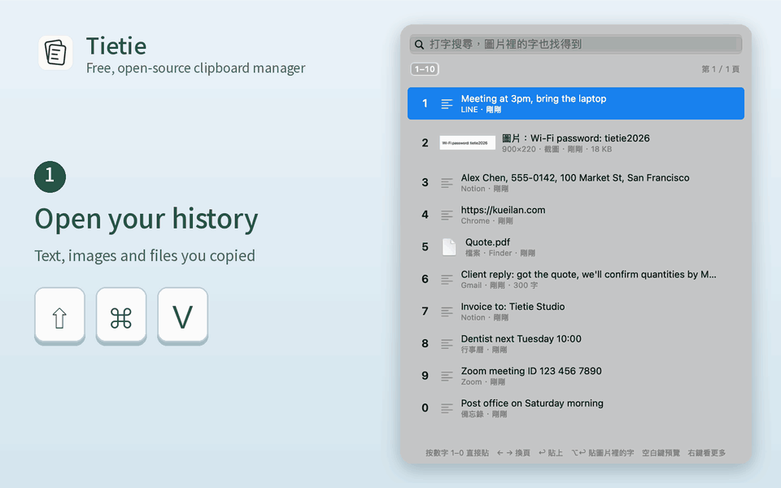

<p align="center"></p>

<h1 align="center">Tietie</h1>

<p align="center">For people who copy and paste all day. A free, open-source clipboard manager for Mac and Windows.<br>
It remembers the text, images and files you copy. Press a shortcut to open your history, then press the number you see to paste it.<br>
<sub>Available in English, 繁體中文, 简体中文, 日本語, 한국어, Português and Español. It follows your computer's language (from version 0.5.0).</sub></p>

<p align="center"><b><a href="#install">Install for free (Mac / Windows)</a></b>　|　<a href="https://github.com/KLWSharpe/tietie/releases/latest">Downloads</a>　|　<a href="README.md">中文</a></p>

<p align="center"></p>

<p align="center">Made by <a href="https://kueilan.com">KueiLan (奎嵐)</a>, who teaches hands-on AI for everyday work　|　Instagram <a href="https://www.instagram.com/kueilanverse">@kueilanverse</a>　|　Threads <a href="https://www.threads.com/@kueilanverse">@kueilanverse</a></p>

I used Clipy for years. When it stopped opening on newer versions of macOS, I wrote my own with the things I wanted most, like number-key pasting and search inside screenshots, and I'm sharing it for free. The name 貼貼 (tiē tiē) means "paste, paste" in Chinese.

Feedback and ideas are very welcome, and I'll keep updating it. Open an [issue](https://github.com/KLWSharpe/tietie/issues), or message me on Instagram / Threads [@kueilanverse](https://www.instagram.com/kueilanverse).

## What it does

- **See it, press its number**: every item has a number on its left. Open the list and press 1 to 9 or 0 to paste that item right away.
- **Keeps a long history**: up to 1,000 items by default, 10 per page. Use ← → to flip pages.
- **Text, images and files**: screenshots and copied images are kept too, not just text. For files it remembers the location, so a file you moved or deleted can't be pasted again.
- **Search text inside images**: copy a screenshot that has words in it, and later you can find it by typing those words (on-device text recognition).
- **Paste the text from an image**: select an image and press ⌥Enter, or right-click and choose Paste Text in Image. You get the words, not the picture.
- **Clean pastes**: text pasted from Tietie comes without the original font, color or link formatting.
- **Pin**: keep things you use often at the top. Pinned items survive "clear history".
- **One-click clear**: after pasting something sensitive, clear the last 10 minutes or everything from the menu.
- **Passwords: your choice**: on first launch it asks whether to keep items copied from password managers. You can change this later in settings.
- **Your history stays on your computer**: Tietie only talks to GitHub to check for new versions. It never sends your history anywhere.
- **Your language**: the interface comes in English, Traditional Chinese, Simplified Chinese, Japanese, Korean, Portuguese and Spanish. It follows your computer's language automatically and falls back to English. You can also pick one under Language in the Tietie menu, and it switches right away (version 0.5.0 and later).
- **Update reminders**: when a new version is out, you'll see a prompt. Click Update Now and it installs in a few seconds, keeping your history. You can also choose Check for Updates… from the menu.

## Install

### Mac

macOS 13 or later, Apple silicon or Intel. Open Terminal (press ⌘ + Space, type `Terminal`, press Enter), paste this line and press Enter:

```bash
curl -fsSL https://raw.githubusercontent.com/KLWSharpe/tietie/main/install.sh | bash
```

It downloads the latest version into your Applications folder and opens it. No password needed. You can read exactly what it does in [install.sh](install.sh).

Prefer to download it yourself? Get `Tietie.zip` from the [downloads page](https://github.com/KLWSharpe/tietie/releases/latest), unzip it and drag Tietie into Applications. Tietie isn't notarized by Apple (that costs $99 a year), so the first time macOS will block it. Go to System Settings → Privacy & Security, scroll down to Security and click "Open Anyway". You only do this once.

### Windows

Windows 10 or 11. Press the Windows key, type `PowerShell`, press Enter, paste this line and press Enter:

```powershell
irm https://raw.githubusercontent.com/KLWSharpe/tietie/main/install.ps1 | iex
```

No password needed. You can also download `Tietie-Windows.zip` from the [downloads page](https://github.com/KLWSharpe/tietie/releases/latest).

Version 0.4.0 and later will prompt you when there's an update. On 0.3.0 or earlier, just run the same line again; your history is kept.

Step-by-step guides with screenshots (in Chinese): [Mac](docs/安裝教學.md) | [Windows](docs/Windows安裝教學.md)

## How to use (Mac)

On Windows, swap ⌘ for Ctrl and ⌥ for Alt. The list opens with Ctrl + Shift + V.

| Key | What it does |
|---|---|
| ⇧⌘V | Open the list (can be changed to ⌥⌘V or ⌃⌘V in settings) |
| Just type | Search, including text inside images |
| ↑ ↓ | Move up and down. Pressing ↓ on the last item of a page goes to the next page |
| ← → | Flip pages: 10 items per page, → shows items 11 to 20, and so on (hold ⌥ when the search box has text). You can also click the page tabs above the list |
| Enter | Paste the selected item |
| ⌥Enter | On an image, paste the text inside it (or ⌥-click) |
| Right-click | Menu: paste image, paste text in image, preview, pin, delete |
| 1 to 9, 0 | Paste that item on the current page, 0 is the 10th. When the search box has text, use ⌘ + number. To search for something that starts with a number, hold ⌥ while typing the first digit |
| Space | Quick preview (when the search box is empty) |
| ⌘Y | Quick preview (any time) |
| ⌥P | Pin or unpin |
| ⌘⌫ | Delete this item |
| Esc | Close |

The Tietie icon in the menu bar has: Pause Recording, Clear Last 10 Minutes, Clear All History, Settings and Language.

### Turn on auto-paste once (Mac)

For Tietie to paste for you after you pick an item, turn it on in System Settings → Privacy & Security → Accessibility. Tietie takes you there the first time. Without it everything still works; you just press ⌘V yourself after picking.

After each update, turn this permission on again: choose Turn On Auto-Paste from the Tietie menu and switch Tietie on in System Settings. The switch may already look on, but it belongs to the old version. Because Tietie isn't part of Apple's paid developer program, macOS treats each new version as a different app.

## Good to know

- Text recognition reads Traditional Chinese and English. On Windows it uses the built-in Windows OCR, so add Chinese in Windows language settings if you need Chinese recognized.

## Privacy

- Your history is stored on your own computer: `~/Library/Application Support/Tietie/` on Mac, `%APPDATA%\Tietie\` on Windows, readable only by your user account.
- Tietie only connects to GitHub to check for new versions. It doesn't collect any data.
- History isn't encrypted separately. If you share your computer, consider turning off "Keep logins copied from password managers" in settings.
- By default it keeps up to 1,000 items and up to 2 GB of images, deleting the oldest when it's over. Pinned items are never deleted. You can change both in settings.

## Uninstall

Mac:

1. In Tietie's settings, uncheck "Start Tietie when I log in", then choose Quit Tietie from the menu bar icon.
2. Move Tietie from Applications to the Trash.
3. To remove your history too, move `~/Library/Application Support/Tietie` to the Trash.

Windows: see the uninstall section of the [Windows guide](docs/Windows安裝教學.md#移除).

## Build from source

You need Apple's Command Line Tools (`xcode-select --install`).

```bash
git clone https://github.com/KLWSharpe/tietie.git
```

```bash
cd tietie && ./scripts/build.sh
```

The app ends up in `build/Tietie.app`.

The Windows version lives in `windows/` and needs the .NET 8 SDK:

```powershell
dotnet publish windows/Tietie/Tietie.csproj -c Release -r win-x64 --self-contained true -p:PublishSingleFile=true
```

### Translations

All interface text lives in `i18n/`, one JSON file per language (`zh-Hant.json` is the original). The Mac app reads these files directly. The Windows app uses .NET resource files; after editing a JSON file, regenerate them with the line below, which also checks that no language is missing an entry:

```bash
python3 scripts/i18n.py
```

Want to fix a translation or add a language? Edit the JSON file and open a pull request.

## License

MIT License. Free to use, modify and share.

## About the author

I'm KueiLan (奎嵐). I teach people how to use AI in their everyday work. I've built Tietie with AI since the very first version, and the test log for every release is [here](docs/驗收紀錄.md) (in Chinese).

- Website: [kueilan.com](https://kueilan.com)
- Instagram: [@kueilanverse](https://www.instagram.com/kueilanverse)
- Threads: [@kueilanverse](https://www.threads.com/@kueilanverse)

If you find it useful, a Star or sharing it with a friend means a lot.
