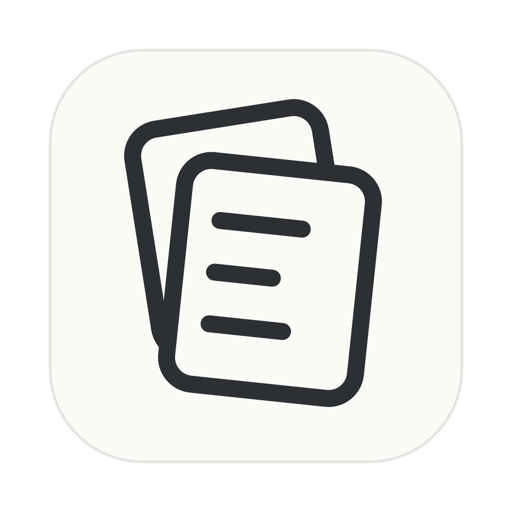
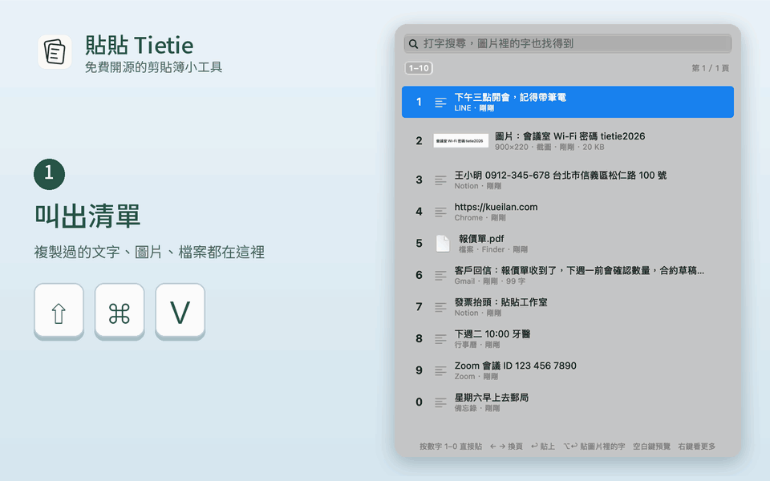

<p align="center"></p>

<h1 align="center">貼貼 Tietie</h1>

<p align="center">給每天複製貼上很多次的人。免費、開源的剪貼簿小工具，Mac 和 Windows 都能用。<br>
複製過的文字、圖片、檔案它都記得，按一組快捷鍵叫出來，看到第幾筆就按數字幾。</p>

<p align="center"><b><a href="#安裝">免費安裝（Mac／Windows）</a></b>　｜　<a href="https://github.com/KLWSharpe/tietie/releases/latest">下載頁</a>　｜　<a href="README.en.md">English</a></p>

<p align="center"></p>

<p align="center">作者：<a href="https://kueilan.com">奎嵐 KueiLan</a>，AI 實戰教學　｜　IG <a href="https://www.instagram.com/kueilanverse">@kueilanverse</a>　｜　Threads <a href="https://www.threads.com/@kueilanverse">@kueilanverse</a></p>

我用了好幾年的 Clipy。後來它在新版 macOS 上打不開了，我就自己寫了一個更強的，免費分享給大家。

歡迎給回饋與建議，之後會幫大家更新。有想法或安裝卡住，可以私訊 IG／Threads [@kueilanverse](https://www.instagram.com/kueilanverse)、寄信到 klwsharpe@gmail.com，或到 [Issues](https://github.com/KLWSharpe/tietie/issues) 留言。

**覺得好用，請幫我按這一頁右上角的 ☆ Star。** 星星多了，貼貼才能被更多 Mac 軟體推薦清單收錄，讓更多人找到它。按 Star 要先登入 GitHub，註冊免費。

**第一次安裝請看一步一步的安裝教學：[Mac 版](docs/安裝教學.md)｜[Windows 版](docs/Windows安裝教學.md)**

## 它能做什麼

- **看到第幾個，就按數字幾**：每一筆左邊都有號碼，叫出清單後直接按 1 到 9、0，就貼上那一筆。
- **記很多筆也找得到**：預設最多記 1000 筆，一頁 10 筆，按 ← → 換頁。
- **記住文字、圖片、檔案**：截圖、複製的圖片都會留下來，不只有文字。檔案記的是位置，原檔搬走或刪掉後就貼不回去。
- **圖片裡的字也搜得到**：複製一張有字的截圖，之後打關鍵字就能找到那張圖。
- **圖片裡的字可以直接貼出來**：選到圖片按 ⌥Enter，或按右鍵選「貼上圖片裡的文字」，貼出來的是字不是圖。
- **貼出來是乾淨的**：從貼貼貼上的文字不帶原本的字體、顏色、連結格式。
- **釘選**：常用的內容釘在最上面，清除歷史時不會被刪。
- **一鍵清除**：貼完敏感內容後，從貼貼的選單就能清掉最近 10 分鐘或全部記錄。
- **密碼要不要記，你決定**：第一次打開就會問你，之後可以在設定裡更改。
- **記錄不上網**：所有記錄只存在你自己的電腦。貼貼只會連到 GitHub 查有沒有新版本，不會傳出任何記錄。
- **跟著電腦的語言**：介面有繁體中文、English、简体中文、日本語、한국어、Português、Español 七種語言，會自動跟著電腦的語言切換，電腦是其他語言時用英文。也可以從貼貼選單的「語言」自己選，選了馬上換（0.5.0 起）。
- **有新版會提醒你**：出新版時會跳出提示，按「立即更新」幾秒就裝好，原本的記錄都會留著。也可以從貼貼的選單按「檢查更新…」。

## 安裝

### Mac

需要 macOS 13 以上，Apple 晶片和 Intel 都可以。打開「終端機」（按 ⌘ + 空白鍵，打「終端機」，按 Enter），貼上這一行，按 Enter：

```bash
curl -fsSL https://raw.githubusercontent.com/KLWSharpe/tietie/main/install.sh | bash
```

詳細步驟、不用終端機的裝法、常見問題：[Mac 安裝教學](docs/安裝教學.md)

### Windows

Windows 10 和 11 都可以。按 Windows 鍵，打 `PowerShell`，按 Enter，貼上這一行，按 Enter：

```powershell
irm https://raw.githubusercontent.com/KLWSharpe/tietie/main/install.ps1 | iex
```

詳細步驟、不用 PowerShell 的裝法、常見問題：[Windows 安裝教學](docs/Windows安裝教學.md)

兩種都不需要輸入密碼。0.4.0 以後的版本出新版時會自動跳出提示，按「立即更新」就好；0.3.0 以前的版本請再貼一次同一行，原本的記錄會留著。

## 怎麼用（Mac）

Windows 的快捷鍵請看 [Windows 安裝教學](docs/Windows安裝教學.md#快捷鍵)，大致是把 ⌘ 換成 Ctrl、⌥ 換成 Alt，叫出清單是 Ctrl + Shift + V。

| 按鍵 | 作用 |
|---|---|
| ⇧⌘V | 叫出清單（可在設定換成 ⌥⌘V 或 ⌃⌘V） |
| 直接打字 | 搜尋，圖片裡的字也找得到 |
| ↑ ↓ | 上下選擇，到這頁最後一筆再按 ↓ 會接到下一頁 |
| ← → | 換頁：一頁 10 筆，按 → 看第 11 到 20 筆，再按看第 21 到 30 筆（搜尋框有字時按住 ⌥）。清單上方的分頁標籤也可以直接點 |
| Enter | 貼上選到的那一筆 |
| ⌥Enter | 選到圖片時，貼出圖片裡的文字（按住 ⌥ 用滑鼠點也可以） |
| 滑鼠右鍵 | 選單：貼上圖片、貼上圖片裡的文字、預覽、釘選、刪除 |
| 數字 1 到 9、0 | 直接貼上這一頁的第幾筆，0 是第 10 筆。搜尋框有字時改按 ⌘ 加數字；要搜尋開頭是數字的內容，第一個數字按住 ⌥ 再打 |
| 空白鍵 | 放大預覽（搜尋框是空的時候） |
| ⌘Y | 放大預覽（隨時可用） |
| ⌥P | 釘選或取消釘選 |
| ⌘⌫ | 刪掉這一筆 |
| Esc | 關閉 |

右上角選單列的貼貼圖示裡有：暫停記錄、清除最近 10 分鐘的記錄、清除全部歷史記錄、設定、語言。

### Mac 的自動貼上要開一次權限

要讓貼貼在你選好之後直接幫你貼上，需要到「系統設定 → 隱私權與安全性 → 輔助使用」把貼貼打開。第一次使用時貼貼會帶你過去。沒有開也能用，只是選好之後要自己按一次 ⌘V。

每次更新到新版之後，這個權限要重新打開一次：從右上角貼貼選單按「開啟自動貼上權限」，再把系統設定裡的貼貼打開。系統設定裡的開關看起來亮著，其實是給舊版的，新版用不到，所以一定要從貼貼的選單重新開一次。這是因為貼貼沒有付費加入 Apple 的開發者計畫，macOS 會把每個新版當成另一個程式。

## 隱私

- 記錄存在你自己的電腦：Mac 在 `~/Library/Application Support/Tietie/`，Windows 在 `%APPDATA%\Tietie\`，只有你自己的帳號讀得到。
- 貼貼只會連到 GitHub 查有沒有新版本，不收集任何資料。
- 記錄沒有另外加密。能打開你電腦的人就看得到，電腦會借人或多人共用時，建議在設定裡關掉「記錄密碼管理器複製的帳號密碼」。
- 預設最多保留 1000 筆、圖片最多佔用 2 GB，超過會自動刪掉最舊的，釘選的不會被刪。可以在設定裡調整。

## 移除

Mac：

1. 到貼貼的「設定」取消勾選「開機後自動啟動貼貼」，再從右上角選單按「結束貼貼」。
2. 把「應用程式」裡的 Tietie 丟到垃圾桶。
3. 想連記錄一起刪掉的話，把 `~/Library/Application Support/Tietie` 資料夾也丟到垃圾桶。

Windows：請看 [Windows 安裝教學的移除段落](docs/Windows安裝教學.md#移除)。

## 自己從原始碼組裝

需要 Apple 的 Command Line Tools（`xcode-select --install`）。

```bash
git clone https://github.com/KLWSharpe/tietie.git
```

```bash
cd tietie && ./scripts/build.sh
```

成品會在 `build/Tietie.app`。

Windows 版的原始碼在 `windows/` 資料夾，需要 .NET 8 SDK：

```powershell
dotnet publish windows/Tietie/Tietie.csproj -c Release -r win-x64 --self-contained true -p:PublishSingleFile=true
```

### 介面文字與翻譯

所有介面文字都在 `i18n/` 資料夾，一個語言一個檔案（`zh-Hant.json` 是原稿）。Mac 版直接讀這些檔案；Windows 版用 .NET 資源檔，改完 json 後執行下面這行重新產生，它也會檢查每個語言的項目有沒有漏：

```bash
python3 scripts/i18n.py
```

想幫忙翻譯或修正某個語言，歡迎直接改對應的 json 送 Pull Request。

## 授權

MIT License。免費使用、修改、再分享。

## 作者

奎嵐 KueiLan，教大家把 AI 用進日常工作。貼貼從第一版到現在，都是我和 AI 一起寫出來的，每一版的測試紀錄放在[驗收紀錄](docs/驗收紀錄.md)。

- 網站：[kueilan.com](https://kueilan.com)
- IG：[@kueilanverse](https://www.instagram.com/kueilanverse)
- Threads：[@kueilanverse](https://www.threads.com/@kueilanverse)

覺得好用的話，按右上角的 Star 或分享給朋友，就是對我最大的鼓勵。
