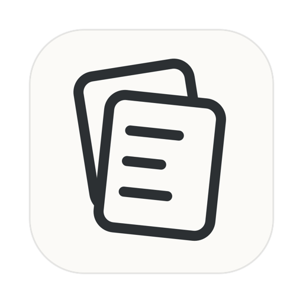
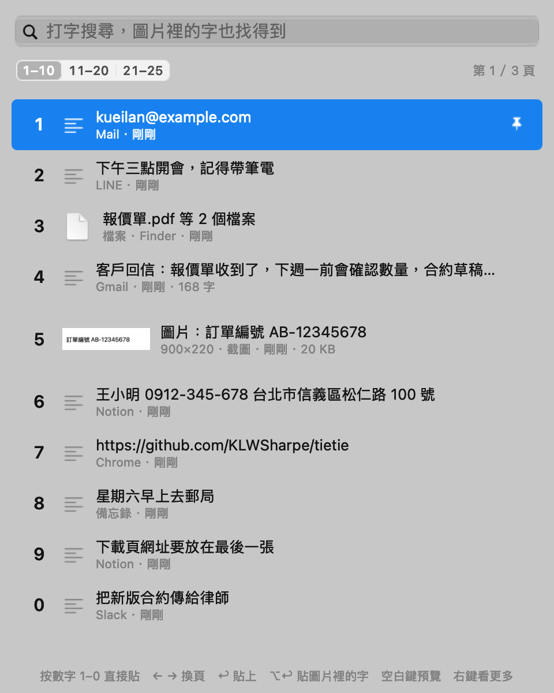

# 貼貼 Tietie

奎嵐 KueiLan 製作的免費、開源剪貼簿小工具，Mac 和 Windows 都能用。記住你複製過的文字、圖片和檔案，按一組快捷鍵就能找回來貼上。

我用了好幾年的 Clipy。後來它在新版 macOS 上打不開了，我就自己寫了一個更強的，免費分享給大家。

歡迎給回饋與建議，之後會幫大家更新。有想法或安裝卡住，可以私訊 IG／Threads [@kueilanverse](https://www.instagram.com/kueilanverse)、寄信到 klwsharpe@gmail.com，或到 [Issues](https://github.com/KLWSharpe/tietie/issues) 留言。

**第一次安裝請看一步一步的安裝教學：[Mac 版](docs/安裝教學.md)｜[Windows 版](docs/Windows安裝教學.md)**



## 它能做什麼

- **看到第幾個，就按數字幾**：每一筆左邊都有號碼，叫出清單後直接按 1 到 9、0，就貼上那一筆。
- **記很多筆也找得到**：預設最多記 1000 筆，一頁 10 筆，按 ← → 換頁。
- **記住文字、圖片、檔案**：截圖、複製的圖片都會留下來，不只有文字。檔案記的是位置，原檔搬走或刪掉後就貼不回去。
- **圖片裡的字也搜得到**：複製一張有字的截圖，之後打關鍵字就能找到那張圖。
- **圖片裡的字可以直接貼出來**：選到圖片按 ⌥Enter，或按右鍵選「貼上圖片裡的文字」，貼出來的是字不是圖。
- **貼出來是乾淨的**：從貼貼貼上的文字不帶原本的字體、顏色、連結格式。
- **釘選**：常用的內容釘在最上面，清除歷史時不會被刪。
- **一鍵清除**：貼完敏感內容後，從貼貼的選單就能清掉最近 10 分鐘或全部記錄。
- **密碼要不要記，你決定**：第一次打開就會問你，之後可以在設定裡更改。
- **不連網**：所有記錄只存在你自己的電腦。

## 安裝

### Mac

需要 macOS 13 以上，Apple 晶片和 Intel 都可以。打開「終端機」（按 ⌘ + 空白鍵，打「終端機」，按 Enter），貼上這一行，按 Enter：

```bash
curl -fsSL https://raw.githubusercontent.com/KLWSharpe/tietie/main/install.sh | bash
```

詳細步驟、不用終端機的裝法、常見問題：[Mac 安裝教學](docs/安裝教學.md)

### Windows

Windows 10 和 11 都可以。按 Windows 鍵，打 `PowerShell`，按 Enter，貼上這一行，按 Enter：

```powershell
irm https://raw.githubusercontent.com/KLWSharpe/tietie/main/install.ps1 | iex
```

詳細步驟、不用 PowerShell 的裝法、常見問題：[Windows 安裝教學](docs/Windows安裝教學.md)

兩種都不需要輸入密碼。要更新到新版，再貼一次同一行就可以，原本的記錄會留著。

## 怎麼用（Mac）

Windows 的快捷鍵請看 [Windows 安裝教學](docs/Windows安裝教學.md#快捷鍵)，大致是把 ⌘ 換成 Ctrl、⌥ 換成 Alt，叫出清單是 Ctrl + Shift + V。

| 按鍵 | 作用 |
|---|---|
| ⇧⌘V | 叫出清單（可在設定換成 ⌥⌘V 或 ⌃⌘V） |
| 直接打字 | 搜尋，圖片裡的字也找得到 |
| ↑ ↓ | 上下選擇，到這頁最後一筆再按 ↓ 會接到下一頁 |
| ← → | 換頁：一頁 10 筆，按 → 看第 11 到 20 筆，再按看第 21 到 30 筆（搜尋框有字時按住 ⌥）。清單上方的分頁標籤也可以直接點 |
| Enter | 貼上選到的那一筆 |
| ⌥Enter | 選到圖片時，貼出圖片裡的文字（按住 ⌥ 用滑鼠點也可以） |
| 滑鼠右鍵 | 選單：貼上圖片、貼上圖片裡的文字、預覽、釘選、刪除 |
| 數字 1 到 9、0 | 直接貼上這一頁的第幾筆，0 是第 10 筆。搜尋框有字時改按 ⌘ 加數字；要搜尋開頭是數字的內容，第一個數字按住 ⌥ 再打 |
| 空白鍵 | 放大預覽（搜尋框是空的時候） |
| ⌘Y | 放大預覽（隨時可用） |
| ⌥P | 釘選或取消釘選 |
| ⌘⌫ | 刪掉這一筆 |
| Esc | 關閉 |

右上角選單列的貼貼圖示裡有：暫停記錄、清除最近 10 分鐘的記錄、清除全部歷史記錄、設定。

### Mac 的自動貼上要開一次權限

要讓貼貼在你選好之後直接幫你貼上，需要到「系統設定 → 隱私權與安全性 → 輔助使用」把貼貼打開。第一次使用時貼貼會帶你過去。沒有開也能用，只是選好之後要自己按一次 ⌘V。

每次更新到新版之後，這個權限要重新打開一次：從右上角貼貼選單按「開啟自動貼上權限」，再把系統設定裡的貼貼打開。系統設定裡的開關看起來亮著，其實是給舊版的，新版用不到，所以一定要從貼貼的選單重新開一次。這是因為貼貼沒有付費加入 Apple 的開發者計畫，macOS 會把每個新版當成另一個程式。

## 隱私

- 記錄存在你自己的電腦：Mac 在 `~/Library/Application Support/Tietie/`，Windows 在 `%APPDATA%\Tietie\`，只有你自己的帳號讀得到。
- 貼貼不連網，不收集任何資料。
- 記錄沒有另外加密。能打開你電腦的人就看得到，電腦會借人或多人共用時，建議在設定裡關掉「記錄密碼管理器複製的帳號密碼」。
- 預設最多保留 1000 筆、圖片最多佔用 2 GB，超過會自動刪掉最舊的，釘選的不會被刪。可以在設定裡調整。

## 移除

Mac：

1. 到貼貼的「設定」取消勾選「開機後自動啟動貼貼」，再從右上角選單按「結束貼貼」。
2. 把「應用程式」裡的 Tietie 丟到垃圾桶。
3. 想連記錄一起刪掉的話，把 `~/Library/Application Support/Tietie` 資料夾也丟到垃圾桶。

Windows：請看 [Windows 安裝教學的移除段落](docs/Windows安裝教學.md#移除)。

## 自己從原始碼組裝

需要 Apple 的 Command Line Tools（`xcode-select --install`）。

```bash
git clone https://github.com/KLWSharpe/tietie.git
```

```bash
cd tietie && ./scripts/build.sh
```

成品會在 `build/Tietie.app`。

Windows 版的原始碼在 `windows/` 資料夾，需要 .NET 8 SDK：

```powershell
dotnet publish windows/Tietie/Tietie.csproj -c Release -r win-x64 --self-contained true -p:PublishSingleFile=true
```

## 授權

MIT License。免費使用、修改、再分享。

## 作者

奎嵐 KueiLan。網站：[kueilan.com](https://kueilan.com)　IG／Threads：[@kueilanverse](https://www.instagram.com/kueilanverse)
