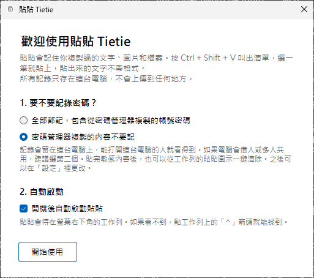

# 貼貼 Tietie 安裝教學（Windows）

**用 Mac 的話，請看 [Mac 安裝教學](安裝教學.md)。** 這一頁是 Windows 的。

照著做大約 3 分鐘。Windows 10 和 Windows 11 都可以用。

## 裝法一：貼一行指令（建議，最順）

你會做的事只有一件：把一行字貼進「PowerShell」這個 Windows 內建的程式。這一行會到 GitHub（放貼貼程式的公開網站）下載最新版，裝到你的電腦，在開始功能表放一個捷徑，然後打開它。

**整個過程不會要你輸入密碼，也不會跳出「是否允許變更」的視窗。** 如果有，請先停下來，改用裝法二。

1. 按鍵盤上的 Windows 鍵（左下角有窗戶圖案的那顆），打 `PowerShell`，按 Enter。會跳出一個藍色或黑色、可以打字的視窗。
2. 把下面這一整行複製起來，在那個視窗裡按滑鼠右鍵貼上（或按 `Ctrl + V`），再按 Enter。

   ```powershell
   irm https://raw.githubusercontent.com/KLWSharpe/tietie/main/install.ps1 | iex
   ```

3. 等十幾秒，看到「完成」就裝好了，PowerShell 可以關掉。

裝好之後，直接跳到下面的「第一次打開：兩個設定」，不用做裝法二。

懂程式的朋友可以在[這裡](../install.ps1)檢查這一行實際做的每一步。

## 裝法二：自己下載（不用 PowerShell，但會被 Windows 多問一次）

先知道一件事：用這個方法，Windows 第一次會跳出藍色的「Windows 已保護您的電腦」。原因是要讓 Windows 不再警告，開發者要另外付費購買數位憑證。貼貼是免費分享的，沒有買，所以 Windows 會多問一次。裝法一不會遇到這一關。

1. 到[下載頁](https://github.com/KLWSharpe/tietie/releases/latest)，點 `Tietie-Windows.zip` 下載。
2. 到「下載」資料夾，在 `Tietie-Windows.zip` 上按右鍵，選「解壓縮全部」，再按「解壓縮」。
3. 把解出來的 `Tietie.exe` 搬到你不會誤刪的地方，例如「文件」資料夾。
4. 點兩下 `Tietie.exe`。**這時會跳出「Windows 已保護您的電腦」**，點文字裡的「其他資訊」，再按「仍要執行」。之後就不會再問。

各版 Windows 的按鈕文字可能略有不同，找意思相近的那一顆就可以。

## 第一次打開：兩個設定

裝好之後會跳出「歡迎使用貼貼」視窗。



1. **複製過的密碼，要不要留在清單裡**（畫面上寫「要不要記錄密碼？」）。這是指你從密碼管理器複製帳號密碼時，貼貼要不要把它跟其他複製的內容一樣留下來。貼貼不會另外去讀你的密碼，所有記錄也只存在這台電腦，不會上傳。畫面預設勾的是第二個「密碼管理器複製的內容不要記」。電腦只有自己用，可以改選第一個「全部都記，包含從密碼管理器複製的帳號密碼」，比較方便。電腦會借人或多人共用，維持第二個。之後都能在設定裡改。
2. **自動啟動**。勾起來，以後開機就會自己跑。

按「開始使用」。Windows 版不需要另外開任何權限。

## 貼貼在哪裡

貼貼住在螢幕右下角的工作列，是一個兩張紙的小圖示。

Windows 11 預設會把小圖示收起來。看不到的話，點工作列右下角的「^」箭頭，就會看到貼貼。想讓它一直露在外面，把它從箭頭裡拖到工作列上就好。

在圖示上按右鍵，可以暫停記錄、清除記錄、打開設定。

## 試試看有沒有成功

1. 隨便選一段字，按 `Ctrl + C` 複製。再複製另一段。
2. 打開「記事本」，在空白的地方點一下，讓游標在那裡閃。
3. 按 `Ctrl + Shift + V`，畫面中間會跳出清單，剛剛複製的兩段都在裡面。
4. 看每一筆左邊的號碼，直接按那個數字（或用上下鍵選一筆按 Enter），它就會貼進記事本。

## 快捷鍵

| 按鍵 | 做什麼 |
| --- | --- |
| Ctrl + Shift + V | 叫出清單（可在設定換成 Ctrl + Alt + V 或 Alt + Shift + V） |
| 直接打字 | 搜尋，圖片裡的字也找得到 |
| ↑ ↓ | 上下選擇，到這頁最後一筆再按 ↓ 會接到下一頁 |
| ← → | 換頁：一頁 10 筆，按 → 看第 11 到 20 筆，再按看第 21 到 30 筆（搜尋框有字時按住 Alt）。清單上方的分頁標籤也可以直接點 |
| Enter | 貼上選到的那一筆 |
| Alt + Enter | 選到圖片時，貼出圖片裡的文字（按住 Alt 用滑鼠點也可以） |
| 滑鼠右鍵 | 選單：貼上、貼上圖片裡的文字、預覽、釘選、刪除 |
| 數字 1 到 9、0 | 直接貼上這一頁的第幾筆，0 是第 10 筆。搜尋框有字時改按 Ctrl 加數字；要搜尋開頭是數字的內容，第一個數字按住 Alt 再打 |
| 空白鍵 | 放大預覽（搜尋框是空的時候） |
| Ctrl + Y | 放大預覽（隨時可用） |
| Alt + P | 釘選或取消釘選 |
| Ctrl + Delete | 刪掉這一筆 |
| Esc | 關閉 |

## 遇到問題

| 狀況 | 怎麼處理 |
| --- | --- |
| PowerShell 沒有出現「完成」，或出現紅色的錯誤 | 先確認網路有連上，把那一行重新貼一次。還是不行就改用裝法二，或把畫面截圖來問。 |
| 防毒軟體說有風險、把貼貼刪掉 | 貼貼沒有買數位憑證，有些防毒軟體會對新的、沒簽名的程式比較緊張。原始碼都公開在 GitHub，可以在防毒軟體裡把它設成允許。 |
| 按 `Ctrl + Shift + V` 沒反應 | 先看右下角（包含「^」箭頭裡）有沒有貼貼的圖示。沒有的話，重新打開貼貼：用裝法一裝的，按 Windows 鍵搜尋「貼貼」；用裝法二裝的，到你放 `Tietie.exe` 的資料夾（例如「文件」）點兩下。有圖示但沒反應，可能是快捷鍵被別的程式用掉，在圖示上按右鍵進「設定」換一組。 |
| 在 Chrome 或 Word 裡，`Ctrl + Shift + V` 原本是「貼上純文字」 | 貼貼開著的時候，這組按鍵會改成叫出貼貼的清單。從貼貼貼出來的本來就是純文字，所以用起來差不多。不習慣的話，到設定換成 `Ctrl + Alt + V`。 |
| 圖片裡的中文搜不到 | 文字辨識用的是 Windows 內建的功能，要有安裝中文語言。繁體中文的 Windows 本來就有。英文版 Windows 要到「設定 → 時間與語言 → 語言」加入中文（台灣）。 |
| 複製了但清單裡沒有 | 在圖示上按右鍵，確認「暫停記錄」沒有被勾起來。從密碼管理器複製的內容，在選了「不要記」時本來就不會出現。 |

還是卡住的話，可以直接找奎嵐，用你習慣的方式就好：

- IG 或 Threads 私訊：[@kueilanverse](https://www.instagram.com/kueilanverse)
- Email：klwsharpe@gmail.com
- 網站：[kueilan.com](https://kueilan.com)
- 有 GitHub 帳號的話，也可以到 [Issues](https://github.com/KLWSharpe/tietie/issues) 留言

請附上三件事，會比較快找到原因：你的 Windows 版本、卡在哪一步、畫面上寫了什麼（截圖最好）。

## 更新

- 用裝法一裝的：再貼一次同一行指令，就會換成最新版。
- 用裝法二裝的：先在貼貼圖示上按右鍵選「結束貼貼」，再下載新的 `Tietie-Windows.zip`，用新的 `Tietie.exe` 取代舊的。

原本的記錄都會留著。

## 移除

1. 在貼貼圖示上按右鍵進「設定」，取消勾選「開機後自動啟動貼貼」，再按右鍵選「結束貼貼」。
2. 用裝法一裝的：按 `Windows 鍵 + R`，貼上 `%LOCALAPPDATA%\Programs`，按 Enter，把 `Tietie` 資料夾刪掉。開始功能表裡的「貼貼 Tietie」捷徑也可以一起刪。用裝法二裝的：把你放的 `Tietie.exe` 刪掉。
3. 想連記錄一起刪掉：按 `Windows 鍵 + R`，貼上 `%APPDATA%`，按 Enter，把 `Tietie` 資料夾刪掉。
