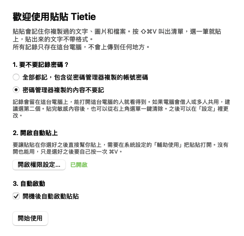

# 貼貼 Tietie 安裝教學

從沒用過終端機也沒關係，照著做大約 3 分鐘。

## 先確認兩件事

- **只有 Mac 能用**。Windows 本身已經有內建的剪貼簿記錄，按 `Win + V` 就能打開。
- **macOS 要 13 以上**。點螢幕左上角的蘋果圖示，選「關於這台 Mac」，就看得到版本。Apple 晶片和 Intel 的 Mac 都可以。

## 裝法一：貼一行指令（建議，最順）

你會做的事只有一件：把一行字貼進「終端機」這個 Mac 內建的程式。這一行會到 GitHub（放貼貼程式的公開網站）下載最新版，放進「應用程式」資料夾，然後打開它。

**在終端機這個視窗裡，不會要你輸入密碼。** 如果這個視窗要你輸入密碼，請先停下來，關掉終端機，改用裝法二。之後開權限時，「系統設定」會要你輸入 Mac 密碼或按指紋，那是正常的。

1. 同時按 Command（⌘）和空白鍵，螢幕中間會出現一條搜尋列。打「終端機」（系統是英文的話打 Terminal），按 Enter。會跳出一個可以打字的視窗。
2. 把下面這一整行複製起來，貼進那個視窗，按 Enter。

   ```bash
   curl -fsSL https://raw.githubusercontent.com/KLWSharpe/tietie/main/install.sh | bash
   ```

3. 中間會跑出幾行字，是正常的。等幾秒，看到「完成」就裝好了，終端機可以關掉。

裝好之後，直接跳到下面的「第一次打開：三個設定」，不用做裝法二。

懂程式的朋友可以在[這裡](../install.sh)檢查這一行實際做的每一步。

## 裝法二：自己下載（不用終端機，但步驟比較多）

先知道一件事：用這個方法，macOS 第一次會把貼貼擋下來。原因是 Apple 要求開發者每年付 99 美元，才會幫程式蓋上「已驗證」的章。貼貼是免費分享的，沒有付這筆錢，所以 macOS 會多問一次。裝法一不會遇到這一關。

1. 到[下載頁](https://github.com/KLWSharpe/tietie/releases/latest)，點 `Tietie.zip` 下載。
2. 到「下載項目」資料夾，點兩下 `Tietie.zip`，會解出一個「Tietie」。
3. 把「Tietie」拖到 Finder 視窗左邊欄的「應用程式」。
4. 到「應用程式」點兩下打開 Tietie。**這時 macOS 會擋下來**，說無法驗證它。先按「完成」，不要按「丟到垃圾桶」。
5. 打開「系統設定」，點左邊的「隱私權與安全性」，一直往下捲到「安全性」那一區，會看到一行提到 Tietie 被擋下，按旁邊的「強制打開」。
6. 系統會再確認一次，按「強制打開」，輸入這台 Mac 的登入密碼或按指紋。之後就不會再問。

各版 macOS 的按鈕文字可能略有不同，找意思相近的那一顆就可以。

## 第一次打開：三個設定

裝好之後會跳出「歡迎使用貼貼」視窗。



1. **複製過的密碼，要不要留在清單裡**（畫面上寫「要不要記錄密碼？」）。這是指你從密碼管理器複製帳號密碼時，貼貼要不要把它跟其他複製的內容一樣留下來。貼貼不會另外去讀你的密碼，所有記錄也只存在這台 Mac，不會上傳。電腦只有自己用，選「全部都記」比較方便。電腦會借人或多人共用，選「不要記」。之後都能在設定裡改。
2. **開啟自動貼上**。這個權限只用來在你選好內容之後，替你按一次貼上。按「開啟權限設定…」，系統設定會打開到「輔助使用」，把清單裡的「Tietie」開關打開，這時要輸入 Mac 的登入密碼或按指紋。回到貼貼視窗，按鈕旁邊的字變成綠色的「已開啟」就成功了。
   - 清單裡找不到 Tietie 的話，按清單下方的「+」，到「應用程式」選 Tietie。
   - 這一步跳過也能用，只是選好內容之後要自己再按一次 `⌘V`。
3. **自動啟動**。勾起來，以後開機就會自己跑。

按「開始使用」。螢幕右上角的選單列會多一個兩張紙的小圖示，那就是貼貼。

## 試試看有沒有成功

1. 隨便選一段字，按 `⌘C` 複製。再複製另一段。
2. 打開「備忘錄」，在空白的地方點一下，讓游標在那裡閃。
3. 按 `⇧⌘V`（同時按 Shift、Command、V），畫面中間會跳出清單，剛剛複製的兩段都在裡面。
4. 用上下鍵選一筆，按 Enter，它就會貼進備忘錄。剛才沒開自動貼上的話，會看到「已複製」，再按一次 `⌘V` 就會貼上。

完整的快捷鍵在[說明頁](../README.md#怎麼用)。

## 遇到問題

| 狀況 | 怎麼處理 |
| --- | --- |
| 終端機沒有出現「完成」，或出現一堆看不懂的錯誤 | 先確認網路有連上，把那一行重新貼一次。還是不行就改用裝法二，或把終端機裡的字截圖來問。 |
| 按 `⇧⌘V` 沒反應 | 先看右上角有沒有貼貼的圖示。沒有的話到「應用程式」點兩下 Tietie。有圖示但沒反應，可能是快捷鍵被別的程式用掉，點貼貼圖示進「設定」換一組。 |
| 選了之後沒有自動貼上，只跳出「已複製」 | 自動貼上的權限沒開。點右上角貼貼圖示，選「開啟自動貼上權限…」，把 Tietie 的開關打開。 |
| 輔助使用裡 Tietie 明明是開的，還是不會自動貼 | 把 Tietie 的開關關掉再打開一次。還是不行，選到 Tietie 按清單下方的「−」移除，再從貼貼選單重新開啟權限。 |
| 更新之後自動貼上失效 | 正常現象。每次更新後要重新打開一次權限，做法同上。 |
| 右上角找不到圖示 | 選單列圖示太多時會被螢幕的瀏海擋住。貼貼其實還在，按 `⇧⌘V` 一樣能用。要點圖示進設定時，先結束一兩個其他選單列上的程式，圖示就會出現。 |
| 複製了但清單裡沒有 | 點貼貼圖示，確認「暫停記錄」沒有被勾起來。從密碼管理器複製的內容，在選了「不要記」時本來就不會出現。 |

還是卡住的話，到 [Issues](https://github.com/KLWSharpe/tietie/issues) 留言（需要 GitHub 帳號），附上你的 macOS 版本和卡在哪一步。

## 更新

- 用裝法一裝的：再貼一次同一行指令，就會換成最新版。
- 用裝法二裝的：重新下載 `Tietie.zip`，先從右上角選單按「結束貼貼」，再把新的 Tietie 拖進「應用程式」取代舊的。

原本的記錄都會留著。

## 移除

1. 點右上角貼貼圖示進「設定」，取消勾選「開機後自動啟動貼貼」，再從選單按「結束貼貼」。
2. 把「應用程式」裡的 Tietie 丟到垃圾桶。
3. 想連記錄一起刪掉：在 Finder 按 `⇧⌘G`，貼上 `~/Library/Application Support/`，把裡面的 `Tietie` 資料夾丟到垃圾桶。
